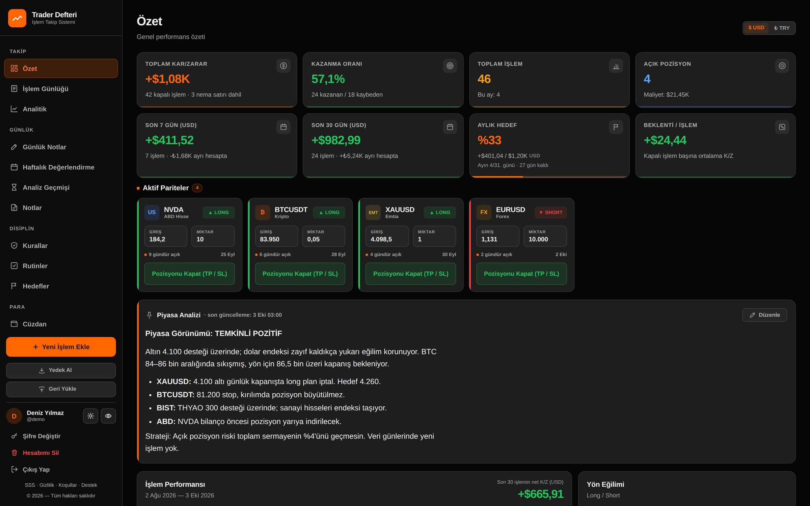
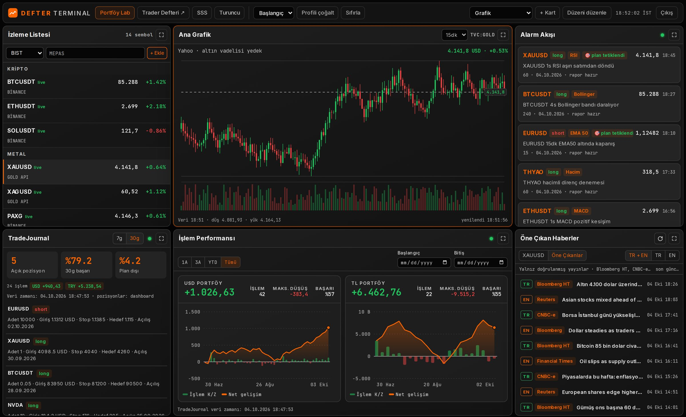
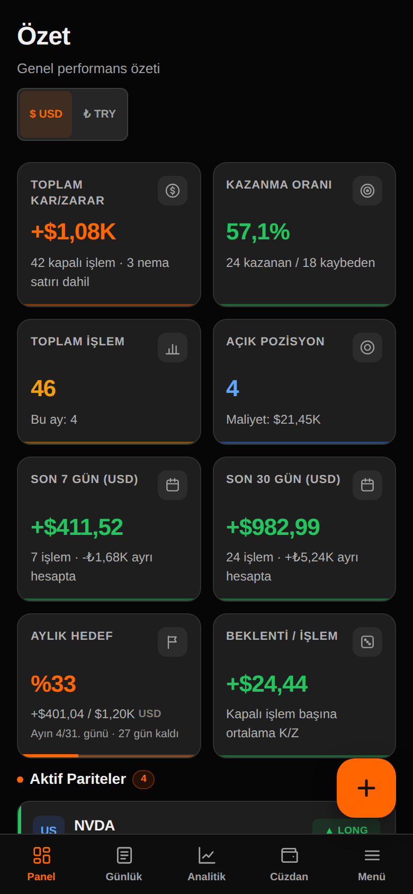
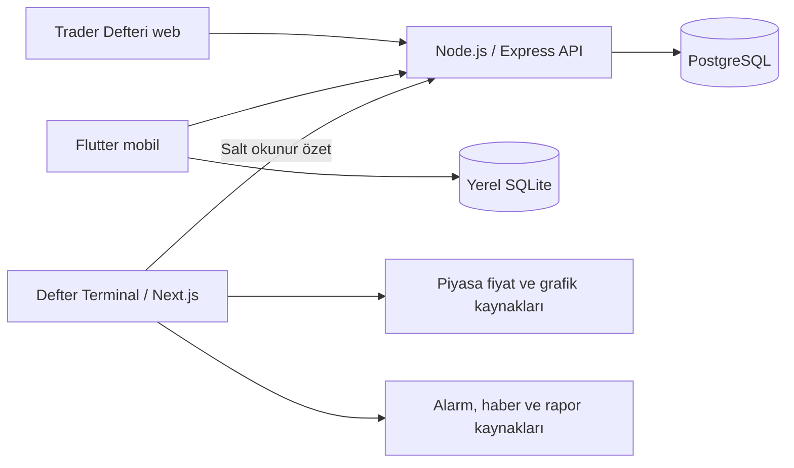

# Trader Defteri & Defter Terminal

**İşlemlerini kaydet, performansını değerlendir, piyasayı tek çalışma alanından izle.**

Trader Defteri, işlem günlüğü ile risk ve disiplin takibini bir araya getirir.
Defter Terminal; grafik, izleme listesi, haber ve raporları düzenlenebilir bir
piyasa ekranında toplar. İki ürün birlikte kullanılabilir; işlem günlüğü bağımsız çalışır.

| Bağlantı | Kullanım |
| --- | --- |
| [Trader Defteri — canlı uygulama](https://app.mehmetfatihdogan.com.tr/) | Web uygulaması; hesapla giriş |
| [Defter Terminal — canlı uygulama](https://terminal.mehmetfatihdogan.com.tr/) | Piyasa çalışma alanı; yetkili hesapla giriş |
| [Tanıtım sitesi](https://defter.mehmetfatihdogan.com.tr/) | Ürün özellikleri, ekranlar ve sık sorulan sorular |
| [Terminal mobil web demosu](https://defter.mehmetfatihdogan.com.tr/defter-terminal.html#mobil-demo) | Örnek verilerle arayüzü deneme |

## Trader Defteri

- **İşlem günlüğü:** giriş/çıkış, yön, miktar, komisyon ve işlem notları; açık ve kapalı pozisyon takibi.
- **Performans analizi:** toplam ve dönemsel kâr/zarar, kazanma oranı, kümülatif sonuçlar ve grafikler.
- **Disiplin:** işlem kuralları, rutinler, günlük notlar, hedefler ve haftalık değerlendirme.
- **Risk ve finans araçları:** pozisyon/risk hesapları, cüzdan ve veri/rapor iş akışları.
- **Web ve mobil:** tarayıcı arayüzü ile Flutter tabanlı Android/iOS uygulaması; aynı hesap üzerinden veri eşitleme.

## Defter Terminal

- **Özelleştirilebilir düzen:** yeniden konumlandırılabilen kartlar ve çalışma alanı profilleri.
- **Piyasa takibi:** çoklu TradingView grafikleri, sembol izleme listeleri ve fiyat kaynakları.
- **Alarm, haber ve raporlar:** kaynaklarıyla okunabilen içerikler ve ayrı paneller.
- **Defter özeti:** işlem performansı, açık pozisyon ve disiplin bilgilerini salt okunur gösterme.
- **Mobil web düzeni:** küçük ekranda grafik, liste ve içerik panellerine sekmelerle erişim.

Trader Defteri mobil görünümü

Ekran görüntüleri ürünlerin kendi arayüzlerinden, kurgusal demo verileriyle hazırlanmıştır.

## Teknoloji

| Katman | Teknoloji ve görevi |
| --- | --- |
| Trader Defteri web | HTML, CSS, JavaScript; Chart.js ile performans grafikleri |
| Trader Defteri API | Node.js, Express; hesap, işlem kayıtları ve eşitleme uçları |
| Kalıcı veri | PostgreSQL; kullanıcı ve işlem kayıtları |
| Mobil | Flutter, Dart; yerel SQLite ve API eşitlemesi |
| Terminal | Next.js, React, TypeScript; düzenlenebilir kartlar ve sunucu tarafı veri köprüleri |
| Piyasa görünümü | TradingView, fiyat sağlayıcıları, haber/rapor akışları |
| Dağıtım | Docker, ters proxy ve HTTPS; ayrı uygulama servisleri |

## Mimari

İşlem günlüğü ile piyasa terminali ayrı servislerdir. Terminal defterin özetlerini
okur; defter kayıtlarını değiştirmez. Piyasa verisi, kişisel işlem kayıtlarından
ayrı tutulur. Mobil uygulama terminalin çalışmasına bağlı değildir.

## Geliştirici

**Mehmet Fatih Doğan** — ürün tasarımı, web/mobil geliştirme, API ve veri modeli,
entegrasyonlar, otomatik kontroller ve dağıtım.

[Portfolyo ve iletişim](https://mehmetfatihdogan.com.tr/) · [GitHub](https://github.com/fatihdogann)

Bu depo ürün tanıtımı, ekran görüntüleri ve mimari özetini içerir. Gizlilik ve
kullanım koşullarına canlı uygulama ve tanıtım sitesinden ulaşılabilir.
