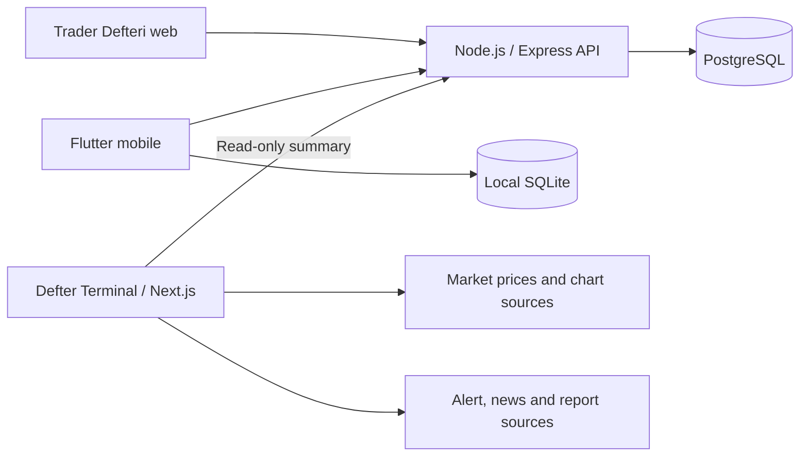

# Trader Defteri & Defter Terminal

**English** · [Türkçe](README.tr.md)

**Log your trades, review your performance and follow the market in one workspace.**

Trader Defteri combines a trading journal with risk and discipline tracking.
Defter Terminal brings charts, watchlists, sourced news and reports into a
customizable market workspace. The journal works independently of the terminal.

| Link | Access |
| --- | --- |
| [Trader Defteri — live app](https://app.mehmetfatihdogan.com.tr/) | Web journal; account required |
| [Defter Terminal — live app](https://terminal.mehmetfatihdogan.com.tr/) | Market workspace; authorized account required |
| [Product website](https://defter.mehmetfatihdogan.com.tr/) | Features, screenshots and FAQs |
| [Terminal mobile web demo](https://defter.mehmetfatihdogan.com.tr/defter-terminal.html#mobil-demo) | Explore the interface with sample data |

## Trader Defteri

- **Trade journal:** entries, exits, direction, quantity, fees and notes; open and closed positions.
- **Performance analysis:** total and period profit/loss, win rate, cumulative results and charts.
- **Discipline:** trading rules, routines, daily notes, goals and weekly reviews.
- **Risk and finance tools:** position/risk calculations, wallet and data/report workflows.
- **Web and mobile:** browser interface and Flutter clients for Android/iOS, synchronized through the same account.

## Defter Terminal

- **Customizable layout:** movable cards and workspace profiles.
- **Market monitoring:** multiple TradingView charts, symbol watchlists and price sources.
- **Alerts, news and reports:** separate panels with source links.
- **Journal summary:** read-only performance, open positions and discipline information.
- **Mobile web layout:** tab-based access to charts, watchlists and content panels.

Trader Defteri mobile view

Screenshots show the products' interfaces with fictitious demo data.

## Technology

| Layer | Technology and purpose |
| --- | --- |
| Journal web client | HTML, CSS, JavaScript; Chart.js for performance charts |
| Journal API | Node.js, Express; accounts, trade records and sync endpoints |
| Persistent data | PostgreSQL; user and trade records |
| Mobile | Flutter, Dart; local SQLite and API synchronization |
| Terminal | Next.js, React, TypeScript; configurable cards and server-side data bridges |
| Market view | TradingView, price providers and news/report feeds |
| Deployment | Docker, reverse proxy and HTTPS; separate application services |

## Architecture

The journal and terminal run as separate services. The terminal reads journal
summaries without modifying journal records. Market data is kept separate from
personal trade records. The mobile journal does not depend on the terminal.

## Developer

**Mehmet Fatih Doğan** — product design, web/mobile development, API and data modeling,
integrations, automated checks and deployment.

[Portfolio & contact](https://mehmetfatihdogan.com.tr/en/) · [GitHub](https://github.com/fatihdogann)

This repository contains the product showcase, screenshots and architecture overview.
Privacy policies and terms are available on the live applications and product website.
